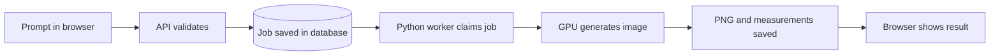

# GenBench, explained as a story

**Companion to:** [GenBench project specification](PROJECT_SPEC.md)

**Audience:** A developer learning AI engineering and full-stack system design for the first time

**Date:** 19 November 2026

## The big picture

Imagine you run a small creative studio. A visitor says, “Make me a lighthouse at dusk.” You have a front desk, a job book, a specialist who operates the image machine, and a shelf where finished pictures are kept. GenBench is that studio as software.

The studio does two useful things: it makes or edits images, and it keeps a careful record of **how** each result was made. Later, it can search those records and run experiments to discover which settings work best on a small GPU.

You do **not** train Stable Diffusion from the beginning. We use pretrained model weights and build the system around them: loading, running, measuring, handling failures, and presenting results. That is real inference engineering.

## Meet the characters

| In the story | In the software | What it does |
|---|---|---|
| Visitor's counter | Next.js web app | Accepts prompts, shows progress and images |
| Front desk clerk | NestJS API | Checks requests, creates jobs, returns results |
| Job book | PostgreSQL | Remembers every job, status, settings, and measurement |
| Membership desk | NestJS auth + PostgreSQL | Creates accounts and checks who owns each job |
| Image specialist | Python GPU worker | Loads Stable Diffusion and generates images |
| Cutout specialist | Python CPU worker | Removes image backgrounds |
| Image machine | GTX 1650 GPU | Runs the heavy image calculations |
| Storage shelf | Files on disk | Holds PNGs, originals, masks, and exports |
| Lab notebook | Benchmark records | Lets us compare settings fairly |

**What exists today:** an early Python image specialist (`services/ml-worker/generate.py`) and the project documentation. The web counter, API clerk, database job book, and other specialists are planned work. The first image run completed calculations but returned a black picture, so the image feature is not yet validated.

When we build the frontend, a visitor first creates an account or logs in. The membership desk gives their browser a session cookie. PostgreSQL stores the account, a password **hash** (not the password), a revocable session record, and a small login history. Each image job has an owner. If another user guesses a job ID, the API still refuses to show that job because ownership is checked on the server.

## Chapter 1 — A visitor asks for an image

Suppose you enter: **“a lighthouse at dusk, oil painting.”** In the finished app, the flow will be:



The front desk does not generate the image while you wait at the counter. It writes a job in the book and quickly gives you a job ID. The worker processes that job separately. This is why the website can remain responsive even when image generation takes minutes.

The job moves through simple states:

`queued → running → succeeded` or `queued → running → failed`

If the computer restarts, the book still contains the job. We can detect a job stuck in `running` and recover it. This is a **durable queue**. For the 4 GB GPU, we allow only one GPU job at a time.

### What happens inside Stable Diffusion?

1. A **tokenizer** breaks the prompt into pieces the text encoder understands. You do not have to write or train this tokenizer for our first model.
2. The **text encoder** turns those pieces into numerical guidance for the image model.
3. A **seed** starts a repeatable stream of random numbers. The model begins with noise, not a finished image.
4. The **U-Net** predicts how to remove noise. A **scheduler** decides how to move from one denoising step to the next. This repeats, for example, 25 times.
5. A **VAE decoder** converts the compact image representation, called a **latent**, into normal pixels.
6. The **safety checker** checks the result. The worker saves the result and its measurements, or records a failure/filtered outcome.

The seed helps repeat an experiment, but identical pixels are not guaranteed when hardware, libraries, or model versions change. That is why the lab notebook also records those versions.

### Why is 4 GB VRAM important?

VRAM is the GPU's working space. Model weights and temporary calculations both use it. The GTX 1650 has about 4 GB, so we test ways to fit the work:

- **FP16:** Store and compute some values in half precision. This can save memory, but we must check that the image is valid on this card.
- **CPU offloading:** Keep some model components in normal RAM until needed on the GPU. This may fit but often costs time.
- **Steps and image size:** Fewer steps may be faster; smaller images often need less memory. Both can change the result.
- **Slicing:** Process parts of some operations separately. It is a setting to measure, not an automatic performance win.

We change **one setting at a time** in experiments. If we change precision, size, and steps together, we cannot tell which change caused the difference.

## Chapter 2 — The first real run and what it taught us

Your first 512×512 run used seed 42, 25 steps, FP16, and no offloading. It finished in about **125 seconds**. PyTorch reported a peak of about **3,257 MiB allocated** and **3,524 MiB reserved** on the GTX 1650. The model downloaded successfully, but the PNG was black. The run also showed a numerical warning and a safety-checker flag.

The next float32 attempt did not test image quality: its full-precision weight download broke before inference. The worker now has the Xet downloader installed. A retry produced a visible lighthouse image, but it was slow and the library ignored the newer `dtype` setting. We fixed that setting and repeated the run. The second image has exactly the same file hash, and its main model parts report float32. A download failure and a model failure are different problems, so we record them separately.

This is a useful engineering observation, **not yet a successful image feature**. A PNG file can exist even when its contents are unusable. We need to inspect pixels and the safety result as well as the job status. We cannot say from one run whether the cause was FP16 behavior, a safety false positive, or another issue.

Our next controlled test keeps the prompt and seed the same and changes precision and memory placement:

```powershell
cd "C:\Users\alyha\Documents\Codex\2026-11-18\st-powershell-for-new-features-and\genbench\services\ml-worker"
$env:HF_HOME = "D:\GenBench\hf-cache"
$env:HF_HUB_DOWNLOAD_TIMEOUT = "60"
.\.venv\Scripts\python.exe generate.py --prompt "a lighthouse at dusk, oil painting" --seed 42 --dtype float32 --offload model
```

This may download more weights and run slowly. We keep the safety checker enabled. After it finishes, open the PNG and JSON sidecar. We need a visible image, no numerical warning, and a clear safety result before calling it the working baseline.

**One measurement trap:** the first run's `cold_load_ms` included the initial download and network retries. It is not a fair measure of model loading. We will separate download, load, warmup, inference, and file-save times before making benchmark charts.

## Chapter 3 — The cutout specialist

Background removal is a separate job. A user uploads a photo or selects one GenBench generated. A segmentation model predicts a **mask**: for each pixel, how much belongs to the subject. We put that mask into the image's **alpha channel** so the background becomes transparent, then save a PNG.

We retain the original image. Fully opaque subject pixels can keep their original RGB values. Hair, glass, and shadows have partly transparent edges, so edge quality needs visual review. This is why we must not promise that every pixel of the cutout is unchanged.

The first cutout model will run on the CPU. That lets background removal work without competing with Stable Diffusion for the 4 GB GPU.

## Chapter 4 — The librarian and embeddings

Once we have many saved generations, searching only by exact words is limiting. Suppose an image was prompted as “a lighthouse at dusk” and someone searches for “coastal evening painting.” An **embedding model** turns each phrase into a list of numbers that represents meaning. Similar ideas often land near one another in this number space.

The librarian stores those vectors in **pgvector**, an extension of PostgreSQL. The first search can compare vectors exactly. If the collection becomes large, we can later test an approximate index and measure its speed and recall.

We do **not** need pgvector to start GenBench. First, plain PostgreSQL acts as the job book for prompts, images, statuses, and measurements. When we reach the Knowledge Lab, we add the extension to that same database and create vectors from the records already saved.

We also ingest approved model documentation and our experiment notes. The ingestion process splits long text into **chunks**, counts tokens, embeds each chunk, and stores its source. We test chunk size instead of assuming one size is best. The starting embedding model has a limited input length, so careless large chunks could be cut off.

**RAG** means *retrieval-augmented generation*: the librarian first finds relevant chunks, then a text model answers using those chunks and cites them. If no source supports an answer, the product says so. For exact benchmark values such as “lowest VRAM,” the app queries the measurement table directly rather than asking a language model to guess a number.

To show that search works, we prepare questions with known relevant sources. **Recall@5** asks: “Of the relevant sources, how many appeared among the first five results?” We also measure search time. We only put a score on a CV after running this labeled evaluation.

## Chapter 5 — A different machine for text and KV caching

The image machine creates pixels by denoising. A small **text model** creates an answer one token at a time. When it writes the next token, it needs information from earlier tokens. A **KV cache** keeps reusable attention values so it does not recompute all of that previous work each time.

KV caching belongs to this text-model experiment. We will not claim that it speeds up the Stable Diffusion image worker. The test uses the same text model and prompts with cache on and off. It records:

- **Time to first token:** how long until the answer begins.
- **Decode speed:** new tokens generated per second after the beginning.
- **Total time:** how long the full answer takes.
- **Peak memory:** the most GPU or CPU memory used.

The cache itself consumes memory. A result may be faster, slower, or fail on this hardware. We will report the measured outcome, prompt length, output length, and number of repeats. We will not insert an imagined “Nx faster” number in a CV.

## Chapter 6 — The lab notebook and fair comparisons

A benchmark is a controlled experiment, not just a stopwatch. Every record needs the model ID and revision, prompt, seed, steps, image size or token counts, precision, offloading/cache setting, software versions, GPU, warmup policy, outcome, time, and memory.

Think of **warmup** as letting a machine get ready before a timed trial. A first call may include setup overhead. We keep cold-start timing separate from warmed inference and repeat measured trials when practical. Failures and black images stay in the raw results; we do not silently remove inconvenient samples.

The dashboard will show a short summary, side-by-side outputs, and raw CSV/JSON. The raw data matters because someone reviewing your project should be able to check the conclusion.

## The build journey

| Chapter to build | What we do | What you should be able to explain afterward |
|---|---|---|
| **M0: Valid image** | Diagnose the black result and make one valid PNG | Prompt, seed, steps, precision, safety checker, VRAM |
| **M1: Reliable worker** | Improve timing and failure records; repeat runs | Cold versus warm time; allocated versus reserved GPU memory |
| **M2: Full stack** | Add PostgreSQL accounts/jobs, NestJS API, Next.js signup/login and image UI | Sessions, job ownership, why the API queues work and why the GPU runs in a worker |
| **M3: Cutout Lab** | Add upload, mask, transparent PNG, comparison | Segmentation mask and alpha channel |
| **M4: Knowledge Lab** | Add embeddings, search, cited answers, tests | Tokenization, vectors, pgvector, RAG, recall@5 |
| **M5: KV-cache Lab** | Add small text model and controlled cache comparison | Autoregressive decoding, cache, tokens/second |
| **M6: Portfolio** | Publish evidence, diagrams, tests, demo | Explain the whole system and defend every number |

### How we will work together

For each milestone, we will first state the question, then run the smallest test that answers it. We will inspect the output, explain what happened in plain language, and only then add the next part of the system. When a command fails, we will keep its log and use it as evidence for the next decision.

Your first learning checkpoint is simple: **Can you explain why the first black PNG does not prove image generation works, even though the model completed 25 steps?** The answer is that a successful computation and saved file do not guarantee a valid visible result; we must inspect the image, numerical warnings, and safety result.

## Short glossary

| Term | Plain meaning |
|---|---|
| **Model weights** | Learned numbers downloaded with a pretrained model |
| **Inference** | Using a trained model to produce a result |
| **Token** | A piece of text a tokenizer gives a model |
| **Seed** | Starting point for repeatable random numbers |
| **Latent** | Compact internal image representation |
| **VRAM** | GPU working memory |
| **Embedding** | A numerical representation used to compare meaning |
| **Vector search** | Finding embeddings near a query embedding |
| **RAG** | Retrieve source material before generating an answer |
| **KV cache** | Reused attention values during token-by-token text generation |
| **Job queue** | Saved work waiting for a worker to process it |

For exact endpoints, database tables, model choices, and acceptance criteria, use the [project specification](PROJECT_SPEC.md). This guide explains the *why* and *how* behind that build plan.
