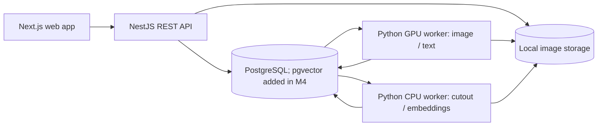

# GenBench — Project specification

**Version:** 1.0

**Date:** 19 November 2026

**Status:** Proposed build specification; implementation and measurements are in progress

New to the project? Read [GenBench, explained as a story](BEGINNER_STORY_GUIDE.md) alongside this specification.

## 1. Product definition

GenBench is a local-first AI workbench for creating images and studying inference on limited hardware. It combines a useful image product with an experiment lab: every model operation records its inputs, output, software version, latency, resource use, and failures. The primary hardware target is a Windows laptop with an NVIDIA GeForce GTX 1650 and 4 GB VRAM.

The product has four connected areas:

1. **Image Lab:** Generate an image from a prompt, save it, repeat it with the same settings, and compare results.
2. **Cutout Lab:** Remove the background from an uploaded or generated image while retaining the original file and the subject's fully opaque pixels.
3. **Knowledge Lab:** Search generations and documentation using embeddings; ask grounded questions about model notes and experiments.
4. **Inference Lab:** Run controlled image and small text-model experiments, including a KV-cache comparison for autoregressive text decoding.

The first release is for one local user. Public multi-user hosting, billing, model training, and claims of proprietary model weights are outside the initial scope.

**Database decision (20 November 2026):** Build M2 with plain PostgreSQL only. Do not install or require pgvector for the image-generation MVP. Add pgvector and RAG in M4 after the image flow and job system are working; existing prompt and experiment records can be embedded then.

## 2. Engineering objective and success criteria

The project should demonstrate both AI engineering and full-stack delivery. It must show a real local model, measured tradeoffs, durable job handling, a usable web interface, tests, and reproducible documentation. A polished interface alone is not a success criterion.

**Final acceptance criteria**

- Generate at least one non-black, unflagged image locally and save a PNG with request metadata and measured inference time and GPU memory.
- Remove a background from an uploaded image and save a transparent PNG, original file, and mask. Verify fully opaque subject pixels match the original.
- Submit, track, recover, and inspect jobs through a Next.js UI, NestJS API, PostgreSQL database, and Python workers.
- Search saved generations semantically and retrieve source-linked documentation chunks. Report recall@5 and query latency from a labeled test set.
- Compare a small autoregressive text model with KV caching on and off. Report time to first token, decode tokens/second, total time, and peak memory from repeated runs. Record failures if the hardware cannot complete a configuration.
- Publish raw benchmark results, charts, test evidence, setup instructions, and a short demonstration.

No speedup, retrieval score, or quality result may be claimed before it is measured.

## 3. User journeys

### Generate and compare

1. The user enters a prompt and selects supported settings.
2. The API validates the request and creates a queued job.
3. One Python GPU worker claims the job, runs the model, and saves the PNG plus metrics.
4. The UI shows queued, running, succeeded, or failed status and a gallery entry.
5. The user opens two results side by side, with their settings and measurements.

### Remove a background

1. The user uploads an image or selects a generated image.
2. A CPU segmentation worker predicts an alpha mask and writes a transparent PNG.
3. The original is retained. The UI shows original, checkerboard preview, mask, and download links.
4. Edge pixels may need partial transparency or color decontamination; the app must not promise that every pixel remains identical.

### Search and ask

1. Generated prompts and curated model/experiment notes are embedded and indexed.
2. Semantic search returns relevant generations or notes with source IDs.
3. For a question, retrieval supplies cited note snippets to a small text model. Numeric benchmark questions use structured database queries so results come from measurements.
4. If supporting evidence is absent, the app says that it does not know.

### Run an experiment

1. The user chooses a fixed prompt or question set, one variable to change, repeats, and a warmup policy.
2. The worker runs configurations sequentially, records every sample, and preserves failures.
3. The UI shows medians, sample counts, raw data, and selected output examples. A CSV/JSON export supports independent review.

## 4. Model and hardware decisions

| Workload | Initial choice | Why | Validation gate |
|---|---|---|---|
| Text-to-image | `stable-diffusion-v1-5/stable-diffusion-v1-5`, Diffusers/PyTorch | Established 512×512 baseline and open weights under CreativeML OpenRAIL-M | Non-black image on the GTX 1650 with safety checker enabled |
| Background removal | U-2-Net via rembg/ONNX Runtime CPU | Runs independently of the scarce GPU and has an Apache 2.0 upstream project license | Transparent PNG, preserved original, acceptable edges on a small test set |
| Text embeddings | `sentence-transformers/all-MiniLM-L6-v2` on CPU | Small local model; 384-dimensional vectors | Measure retrieval accuracy and latency on project data |
| Text generation | Candidate: `Qwen/Qwen2.5-0.5B-Instruct` | Small autoregressive model for a local KV-cache experiment; Apache 2.0 model card | Prove loading and decoding locally before exposing in UI |
| Vector store (M4) | pgvector extension in the existing PostgreSQL database | Adds semantic search without a second database | Install only when Knowledge Lab begins; exact-search baseline first |

The model choices are starting points, not performance guarantees. Pin a working model revision and package set after the first valid run. Do not load the diffusion model and text model on the GPU at the same time. The system has one active GPU job across both workloads; CPU background removal and embedding jobs use separate bounded queues.

**KV caching applies to the text model's token-by-token decoding. It is not an optimization claim for the Stable Diffusion 1.5 U-Net.** The text model's existing tokenizer is used; GenBench does not claim to train a new BPE tokenizer.

## 5. Current evidence and immediate diagnostic

Milestone 1 code exists in `services/ml-worker/generate.py`. Python 3.11, CUDA PyTorch, Diffusers, and the FP16 Stable Diffusion weights were installed by the user. The first run on 19 November 2026 loaded the model and completed 25 steps at 512×512 with seed 42. Its JSON sidecar reported:

- PyTorch `2.14.1+cu130`, Diffusers `0.35.2`, GTX 1650.
- Timed inference: **125,053 ms** (one run; no warmup).
- Peak CUDA allocated/reserved: **3,256.57 / 3,524.00 MiB**.
- The saved PNG is black. The console reported `invalid value encountered in cast`, and the safety checker returned `nsfw_content_detected: [true]`.
- The recorded `cold_load_ms` includes the first model download and retries, so it is **not** a comparable model-load benchmark.

The first float32/model-offload attempt began on 20 November 2026 but failed before inference: the full-precision weight transfer ended with `ChunkedEncodingError` / `IncompleteRead`. No PNG was produced. This is a download failure, not evidence about float32 image quality. `hf_xet` was added to the worker environment for the next attempt.

**Milestone 1 is not complete.** A black file is not a successful image-generation result. The warning and flag may have different causes; investigate without disabling the safety checker. Retry the same prompt and seed with `--dtype float32 --offload model` after the download is complete. This may download additional full-precision weights and run slowly. If that produces a valid image, record it as the working baseline and then isolate the FP16 failure. If it also fails, test another benign prompt/seed and inspect the safety result and pixel statistics. Keep each failed run and its metadata.

The existing script is a prototype. Before benchmark use, separate download time, model-load time, optional warmup time, inference time, and image-save time. Also mark a black or safety-filtered image as unsuitable for quality comparison rather than treating the presence of a PNG as success.

## 6. System architecture



NestJS owns validation, job creation, result URLs, and database access for the web app. Python owns model loading, inference, segmentation, embedding, and profiling. GPU work never runs inside an HTTP request. Use a PostgreSQL job table and transactional claiming for the local MVP; add a separate broker only if measured throughput or operations require it.

The UI should show only supported options returned by `/api/v1/system/capabilities`. The browser receives job IDs and safe image URLs, not raw filesystem paths. The worker should recover stale running jobs after restart and write structured error codes for OOM, model-load, timeout, safety-filter, and invalid-output cases.

## 7. Stack and repository layout

| Layer | Technology | Responsibility |
|---|---|---|
| Web | TypeScript, Next.js, React | Forms, status, galleries, comparisons, experiment results |
| API | TypeScript, NestJS | Validation, jobs, capabilities, results, file streaming |
| ML workers | Python 3.11, PyTorch, Diffusers, ONNX Runtime, Sentence Transformers, Transformers | Inference and metrics |
| Database | PostgreSQL; pgvector added in M4 | Jobs, metadata, benchmark samples; vectors later |
| Storage | Local filesystem in development | Original, generated, cutout, mask, and export files |
| Tests | pytest, API tests, Postman collection, frontend smoke tests | Correctness and reproducibility |

```text
genbench/
  apps/web/
  apps/api/
  services/ml-worker/       # Existing generate.py; later GPU/text worker modules
  services/cpu-worker/      # Cutout and embeddings
  database/migrations/
  postman/
  docs/                    # This spec, architecture, model cards, reports
  data/                    # Local model-independent fixtures, gitignored where needed
  outputs/                 # Generated artifacts, gitignored
  README.md
  .env.example
  .gitignore
```

Keep image, retrieval, and text inference dependencies in separate Python environments or pinned dependency groups if they conflict. Do not commit model weights, generated user images, secrets, or local databases.

## 8. Functional requirements and API

### Image Lab

| Method | Route | Purpose |
|---|---|---|
| `POST` | `/api/v1/generations` | Validate prompt/settings and queue generation |
| `GET` | `/api/v1/generations/:id` | Status, progress, result, sanitized error |
| `GET` | `/api/v1/generations` | Paginated gallery |
| `GET` | `/api/v1/generations/:id/image` | Stream completed PNG |
| `POST` | `/api/v1/benchmarks/image` | Queue a controlled image experiment |
| `GET` | `/api/v1/benchmarks/:id` | Summary and raw samples |

Image request: prompt 1–500 characters; optional negative prompt, seed, steps, guidance, width/height, scheduler, precision, and memory mode. All options are allowlisted and bounded by verified capabilities. A job has `queued → running → succeeded | failed` states with timestamps. A safety-filtered or numerically invalid image has an explicit outcome; it is not silently counted as a valid success.

### Cutout Lab

| Method | Route | Purpose |
|---|---|---|
| `POST` | `/api/v1/cutouts` | Upload/select source and queue removal |
| `GET` | `/api/v1/cutouts/:id` | Status, original/cutout/mask IDs, error |
| `GET` | `/api/v1/cutouts/:id/file/:kind` | Download original, transparent PNG, or mask |

Validate file type, byte size, decoded dimensions, and actual image content. Strip unnecessary metadata from derived downloads. Keep the original intact. Do not perform generative fill or edit the subject unless the user chooses a separate future editing feature.

### Knowledge and text inference

| Method | Route | Purpose |
|---|---|---|
| `POST` | `/api/v1/knowledge/documents` | Ingest approved project notes/docs |
| `DELETE` | `/api/v1/knowledge/documents/:id` | Delete document and associated vectors |
| `GET` | `/api/v1/search/generations` | Semantic search of prompt/history metadata |
| `POST` | `/api/v1/knowledge/ask` | Grounded answer with source IDs or abstention |
| `POST` | `/api/v1/benchmarks/retrieval` | Run labeled retrieval evaluation |
| `POST` | `/api/v1/benchmarks/text` | Run text decoding/cache comparison |

Use the embedding model's tokenizer and test a starting chunk size around 180 tokens with overlap, because the selected embedding model truncates long inputs. Tune chunking against retrieval results, not by intuition alone. Store embedding model ID and revision with each vector. For local MVP, use exact pgvector cosine search first; compare indexed search later if the collection becomes large enough to justify it.

### Operations

`GET /api/v1/system/capabilities` lists verified models, schedulers, precision modes, resolution limits, GPU state, and enabled labs. `GET /api/v1/health` separates API/database liveness from worker readiness. Use local-only access initially, input validation, bounded queues, and sanitized public errors.

## 9. Logical data model

- `models`: model ID, revision, task, license note, validated capabilities.
- `jobs`: UUID, type, status, validated request, timestamps, attempt count, error code, worker heartbeat.
- `images`: UUID, source job, storage key, role (`generated`, `original`, `cutout`, `mask`), dimensions, format, SHA256.
- `generation_metrics`: job ID, model/precision/scheduler, load, warmup, inference and save times, CUDA peak allocated/reserved, versions, GPU.
- `benchmark_runs`: UUID, workload, fixed dataset version, configurations, repeats, status.
- `benchmark_samples`: run ID, job ID, configuration, iteration, warmup flag, outcome, raw metrics.
- `documents`: UUID, title, content hash, source, model/version, ingestion status.
- `chunks`: document ID, ordinal, text, token count, embedding vector, model/revision.
- `retrieval_evaluations`: query ID, relevant source IDs, returned source IDs, recall@k, query time.
- `text_metrics`: job ID, model/tokenizer revisions, prompt/output tokens, cache mode, first-token time, decode tokens/second, total time, peak memory.

Use foreign keys, indexed job state/timestamps, explicit status constraints, and cascade deletion for document chunks. Source paths remain server-side. Store benchmark data even when a run fails.

## 10. Evaluation protocol

### Image generation

Use a versioned set of benign prompts and fixed seeds. Start with one validated baseline. Vary one factor at a time: precision, steps, scheduler, or offloading. Record image size, model revision, software versions, device, driver, and whether a warmup ran. Synchronize CUDA around timed inference, reset peak counters before each measured run, and separate cold startup from steady inference. Run at least three measured repetitions per configuration when practical. Report median, spread, peak allocated/reserved memory, failure count, and representative images. Human review records prompt fidelity and visual defects; no single automated score is treated as definitive quality.

### Background removal

Use a small, licensed set of varied images: simple object, portrait/hair, complex background, transparent/reflective edge. Keep originals. Check output alpha, edge quality, runtime, and whether fully opaque foreground RGB equals the source. If annotated masks are available, report IoU and boundary quality; otherwise label the assessment as visual review.

### Retrieval/RAG

Create a labeled question set with relevant document or generation IDs, including unanswerable queries. Evaluate recall@5 and p50/p95 query latency separately from answer quality. Test document deletion, wrong-source rejection, and citation correctness. Compare against a keyword-search baseline. Do not report a score from a tiny handpicked example as general performance.

### KV caching

Use the same text model, tokenizer, prompts, output-token limits, device, dtype, and sampling policy with cache on and off. Test at multiple input lengths, repeat runs after warmup, and synchronize GPU timing where applicable. Record time to first token, decode tokens/second, total duration, and peak allocated/reserved memory. Report the token count and input lengths with every speed ratio. If a configuration OOMs or falls back to CPU, report that outcome instead of claiming a speedup.

## 11. UI screens

1. **Generate:** prompt and verified settings, queued/running/result/error states.
2. **Gallery:** images, metadata, semantic search, repeat button.
3. **Cutout:** upload/select image, checkerboard preview, original/cutout/mask downloads.
4. **Compare:** two images and their exact settings/measurements side by side.
5. **Knowledge:** documents, source search, cited answers, explicit no-evidence response.
6. **Benchmarks:** image, retrieval, and text experiment setup; tables/charts and CSV export.
7. **System:** installed models, GPU, worker health, storage usage, and supported modes.

The UI must not display fabricated progress percentages or benchmark numbers. If step callbacks are available, show approximate progress and label it as such.

## 12. Milestones and gates

| Milestone | Deliverable | Exit gate |
|---|---|---|
| **M0 — Valid image** | Diagnose FP16 black result; establish working configuration | Non-black, unflagged PNG and JSON on GTX 1650; second run recorded |
| **M1 — Measured image worker** | Reliable CLI, separated timings, repeatable benchmark harness | Controlled image runs with raw samples and OOM handling |
| **M2 — Full stack core** | Plain PostgreSQL jobs, Python worker, NestJS API, Next.js generate/gallery | End-to-end prompt-to-image flow and Postman tests; no vector extension required |
| **M3 — Cutout Lab** | CPU segmentation service and UI | Original + transparent PNG + mask; edge review and file validation |
| **M4 — Knowledge Lab** | Embeddings, pgvector search, grounded Q&A | Labeled recall@5/latency report, citations, deletion test |
| **M5 — KV-cache Lab** | Small text model and cache benchmark | Repeated cache-on/off results with token counts and memory |
| **M6 — Portfolio release** | README, diagrams, raw results, demo video | Another developer can reproduce the validated paths |

Do not advance a model feature merely because its UI is complete. Each gate requires real output and evidence.

## 13. Reliability, privacy, and risks

- **GPU memory:** The GTX 1650 has 4 GB VRAM; keep one GPU job active. Use offloading or lower resolution only after measuring the baseline and quality effect.
- **Numerical/safety behavior:** The first FP16 run was black and safety-flagged. Preserve the safety checker, inspect numerical warnings, and test float32 offloading. Never label a filtered image as a valid visual result.
- **Storage:** Model caches can be large. Keep the Hugging Face cache on the roomier D: drive, monitor free space, and avoid committing weights or output images.
- **Windows dependency compatibility:** Pin versions after a validated run. Keep the requirements for diffusion, CPU segmentation, and text experiments isolated if needed.
- **Retrieval quality:** Embeddings can miss exact numbers and names; include keyword search and structured database lookups where appropriate. Show citations and abstain without evidence.
- **Input safety:** Validate prompts, uploads, dimensions, model IDs, and job limits. Keep services local until authentication and abuse controls exist.
- **Licensing:** Record model ID, revision, and license in the repo. Distinguish pretrained weights from original implementation and research.

## 14. Next actions

1. Run the controlled float32 + model-offload diagnostic using the same prompt and seed; inspect the PNG, `nsfw_content_detected`, numerical warnings, and JSON.
2. Mark valid/invalid image status in the ML worker and separate first-download timing from model-load timing.
3. Freeze the working image configuration and collect a second run before building the database and web app.
4. Add Cutout and Knowledge Labs only after the core image flow is demonstrably working.

## 15. Primary references

- Stable Diffusion 1.5 model card and license: <https://huggingface.co/stable-diffusion-v1-5/stable-diffusion-v1-5>
- Diffusers memory/offloading: <https://huggingface.co/docs/diffusers/main/optimization/memory>
- PyTorch installation: <https://pytorch.org/get-started/locally/>
- U-2-Net and license: <https://github.com/xuebinqin/U-2-Net>
- rembg: <https://github.com/danielgatis/rembg>
- MiniLM embedding model: <https://huggingface.co/sentence-transformers/all-MiniLM-L6-v2>
- pgvector: <https://github.com/pgvector/pgvector>
- Qwen 0.5B model: <https://huggingface.co/Qwen/Qwen2.5-0.5B-Instruct>
- Transformers KV caching: <https://huggingface.co/docs/transformers/main/kv_cache>
